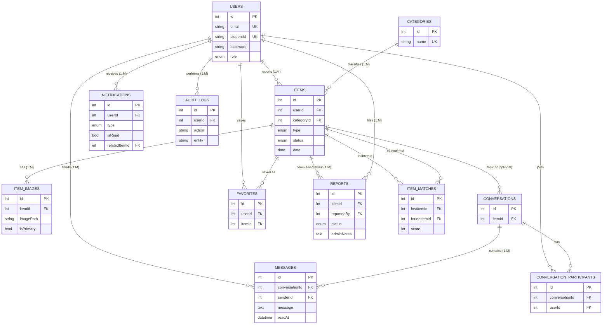

# ER Diagram

## Relationship types
| Type | Relationship | Sequelize | Join table |
|---|---|---|---|
| **1:1** | User - Profile *(profile fields are inside `users`; `hasOne` would be used if split)* | `hasOne` / `belongsTo` | - |
| **1:M** | User -> Items, Category -> Items, Item -> ItemImages, User -> Notifications, User -> Messages, Conversation -> Messages, Item -> Reports, User -> Reports, User -> AuditLogs | `hasMany` / `belongsTo` | - |
| **M:N** | Users <-> Conversations | `belongsToMany` | `conversation_participants` |
| **M:N** | Users <-> Items (favourites) | `belongsToMany` | `favorites` (unique userId+itemId) |
| **M:N** | Items <-> Items (possible matches, lost<->found) | `belongsToMany` (self) | `item_matches` |

All associations are defined in `backend/src/models/index.js`.
